# Stage 2 – Contextual Vulnerability Assessment and Remediation

**Source:** [yonarbel/jfrog_task](https://github.com/yonarbel/jfrog_task) · **Submission:** [jfrog-stage2-assessment](https://github.com/Caspiofri/jfrog-stage2-assessment), work on `main` · Build Info records branch [`stage2/final`](https://github.com/Caspiofri/jfrog-stage2-assessment/tree/stage2/final)
## Summary

This assessment used JFrog Xray Contextual Analysis to investigate vulnerable dependencies in a Node.js application, prioritize remediation based on exploitability, and verify the fix.

- **Assessment:** Three findings were classified as Applicable. Two were rated High by different severity sources: lodash CVE-2018-16487 (JFrog Research) and moment CVE-2022-31129 (CVSS).

- **Prioritization:** I selected lodash because its vulnerable merge operation was reachable through an unauthenticated HTTP endpoint. A local PoC demonstrated process-wide prototype pollution. No reachable HTTP path to the vulnerable moment helper was confirmed.

- **Remediation:** Upgraded lodash from 4.17.4 to 4.17.21 and added application-level protections. The comparable scan showed 93 → 86 findings and 3 → 1 Applicable findings. All nine application tests passed.

- **Delivery:** Built and pushed a `linux/amd64` Docker image to Artifactory and published verified [Build Info #3](https://trialc914kt.jfrog.io/ui/builds/user-management-service/3/1793571105750/published?buildRepo=artifactory-build-info).

---

## 1. Environment & Setup (1a, 1b)

| Component         | Configuration                                |
| ----------------- | -------------------------------------------- |
| JFrog             | Enterprise X Trial, Xray Contextual Analysis |
| Scanner           | JFrog CLI 2.129.0 (`jf audit`)               |
| Local environment | Node.js 22.23.2, npm 10.9.8                  |
| Docker runtime    | `node:14-alpine`                             |
| Source baseline   | `be7a62e`                                    |
| Submission branch | `main` (Build Info records `stage2/final`)   |

### Preparing the Application

The supplied application required several changes before it could be built, tested, and assessed reliably:

- Restored missing `bcrypt` and `validator` dependencies and added a lockfile.

- Pinned `bcrypt` to 5.1.1 for compatibility with the existing Node.js 14 Docker runtime.

- Prevented the HTTP server from starting during test imports.


These preparation changes did not modify lodash or moment. They did, however, affect the dependency tree and were accounted for when comparing scan results.


---

## 2a. Scan and identify the two applicable vulnerabilities

**Question.** Which findings does Contextual Analysis mark Applicable, and which two of them are "High"?

**Tools and inputs.** `jf audit` with Contextual Analysis on the original fork (`be7a62e`), JSON output in `docs/scans/`.

**Raw result.**

| Applicability   | Findings (n = 80) |
| --------------- | ----------------- |
| Applicable      | 3                 |
| Not Applicable  | 40                |
| Missing Context | 7                 |
| Not Covered     | 30                |
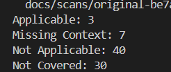


| Finding | Type | CVSS v3 | JFrog Research severity | Applicability |
| --- | --- | --- | --- | --- |
| moment 2.19.3 – CVE-2022-31129 | ReDoS | **High (7.5)** | Medium | Applicable |
| lodash 4.17.4 – CVE-2018-16487 | Prototype pollution | Medium (5.6) | **High** | Applicable |
| lodash 4.17.4 – CVE-2020-28500 | ReDoS | Medium | Medium | Applicable |
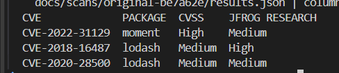

**Conclusion.** The two candidates are moment and lodash. Neither is High on both scales, and the CLI table shows only the CVSS column, so a reader of the default CLI output sees one High, not two. I found the second one only in the full JSON output, which carries JFrog Research's own severity. The assignment does not say which scale "high" means; these are the only two Applicable findings rated High on either.

---

## 2b. What "applicable" means, and why it changes prioritization

A regular vulnerability scan tells which dependencies have known vulnerabilities, but not necessarily whether those vulnerabilities matter to the application.

Contextual Analysis adds another layer: it checks whether the vulnerable code is actually used and whether relevant conditions for exploitation exist. This helps distinguish vulnerabilities that deserve immediate attention from those that are less likely to affect the application.

In my case, the original scan returned 80 findings, but only 3 were marked Applicable. Instead of prioritizing purely by severity, I could focus my investigation on those three.

However, **Applicable does not automatically mean exploitable through the application.** Both lodash and moment were marked Applicable, but my manual investigation showed that lodash could be exploited through an HTTP endpoint, while I could not identify a reachable HTTP path to the flagged moment code.

This is why I prioritized lodash, even though moment had a higher CVSS score: **I had evidence of actual exploitability, not just a severity rating.**

The remaining findings marked Not Covered or Missing Context still require consideration; they should not be assumed safe.

## 2c. My Investigation and Remediation Approach

I followed four steps to investigate the findings, select a remediation, and verify the result:

1. **Reachability:** Can attacker-controlled input reach the vulnerable code through an application entry point?
2. **Exploitability:** Can I reproduce the vulnerability, and what impact can I demonstrate?
3. **Remediation strategy:** Which dependency versions are affected, and what is the smallest effective fix?
4. **Verification:** Does the fix prevent the exploit, remove the targeted finding, and preserve application functionality?

### 1.Reachability Check**

**Objective:** Determine whether the code flagged by Contextual Analysis is reachable through an HTTP endpoint and whether attacker-controlled input can reach it.

**Tools:** JFrog scan output (`results.json`), source code inspection, and static caller tracing.

**Method:** I used `results.json` to identify the relevant CVEs and their flagged source locations, then manually traced each call back to its enclosing function and potential entry points.

**Investigation flow:**

```
1. SCA scan           80 findings in results.json
2. Applicable         3 findings
3. High severity      2 candidates:
                      moment  CVE-2022-31129
                      lodash  CVE-2018-16487
4. Scanner evidence   moment → src/utils/helpers.js:125, 133, 134
                      lodash → src/routes/users.js:143-147
		                     → src/utils/helpers.js:112, 153
5. Code inspection    moment → getUserStats() (line 118)
                      lodash → PUT /api/users/:id handler
6. Caller tracing     moment → no static callers identified
                      lodash → reachable via HTTP endpoint
```


lodash reference from IDE:
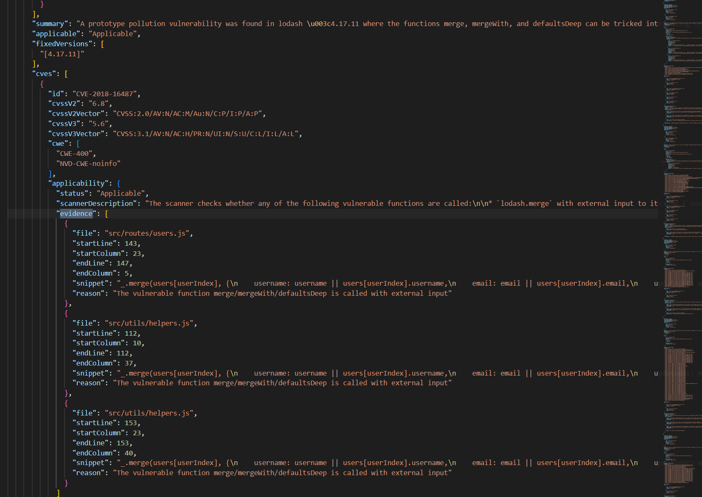

moment reference from IDE:
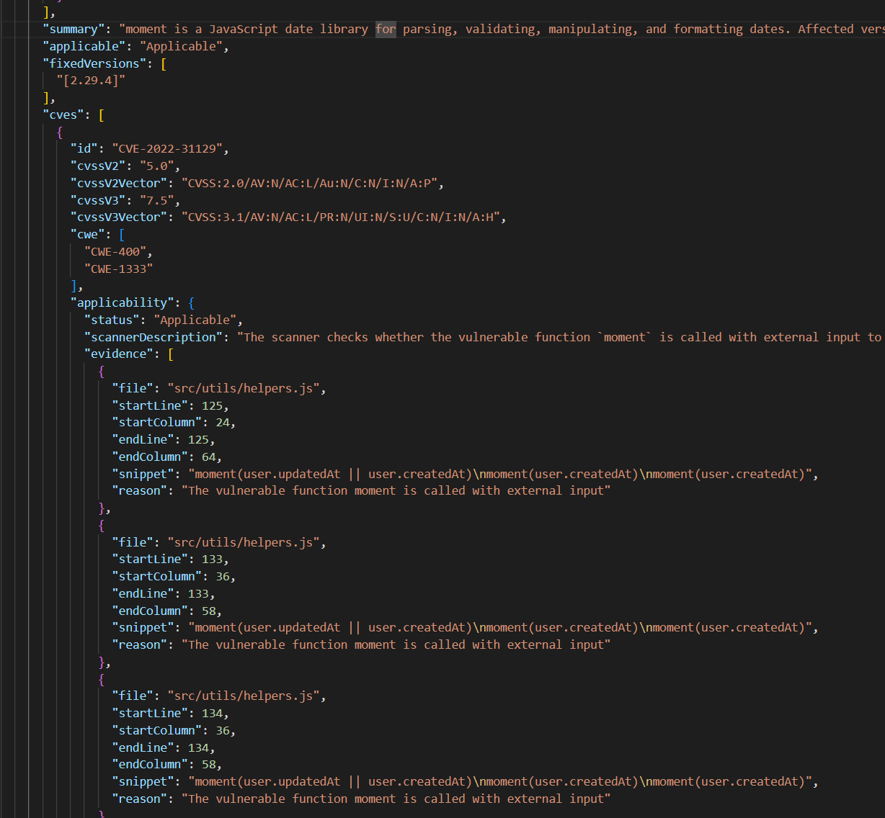

Steps 1–4 were derived from the scan results (Figure 1). Steps 5–6 were verified manually by inspecting the flagged lines, identifying their enclosing functions, and tracing their callers (Figure 2).

#### Raw Findings:

**Lodash — HTTP Reachability**

The flagged `_.merge()` call at `src/routes/users.js:143` is located within a user update handler. I traced its execution path from the application's entry point to the vulnerable library call.

**1. HTTP entry point —** `src/index.js`
The application mounts `userRoutes` at `/api/users` using `app.use('/api/users', userRoutes)`

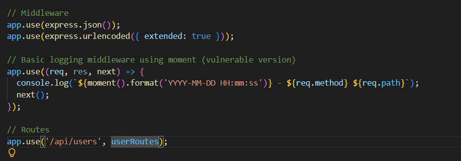

**2. Request handling —** `**src/routes/users.js**`

The `router.put('/:id')` handler processes requests to `/api/users/:id`. It extracts `username` and `email` from `req.body` and passes these values into an object used as the source argument of `_.merge()`.

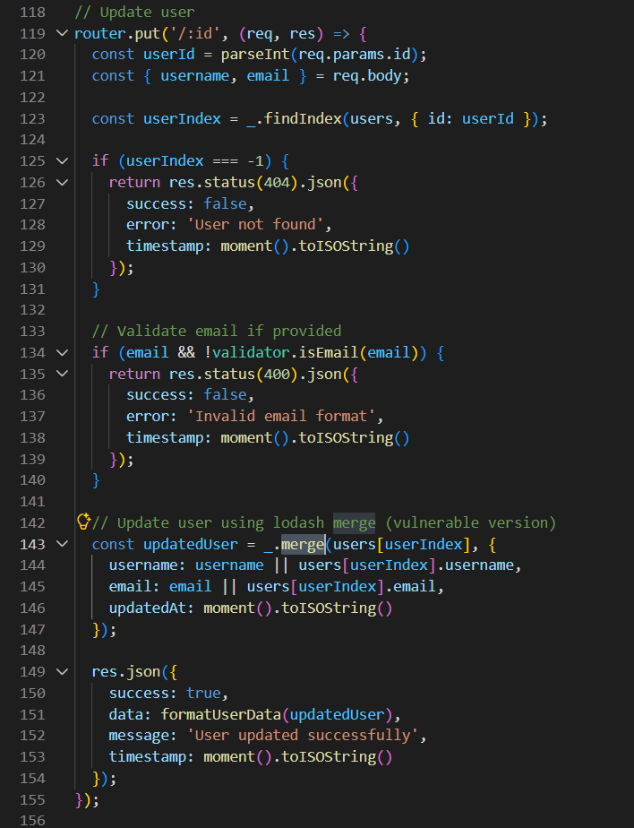

**Finding:** An HTTP execution path to the flagged lodash call was identified. No authentication middleware was identified on the examined route. However, the application uses predefined property names in the merge source, so the conditions required to exploit prototype pollution have not been established.

**3. Additional scanner evidence —** `**src/utils/helpers.js**`

The scanner also flagged two `_.merge()` locations in `helpers.js` (lines 112 and 153). These require separate caller and input-flow analysis before drawing conclusions about their reachability.

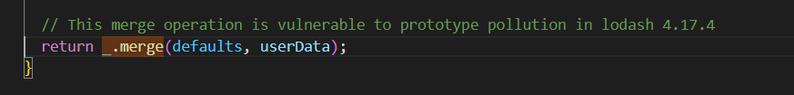

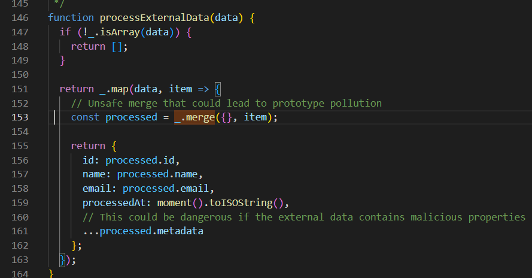

**Moment — No Identified Execution Path**

The scanner flagged three `moment()` calls at lines 125, 133, and 134 inside `getUserStats()` in `src/utils/helpers.js`.

Although the function is exported, no static callers were identified in the examined source code. The scanner reported external input at these three locations, while four other `moment()` calls (lines 45, 50, 123, and 159) were not flagged.

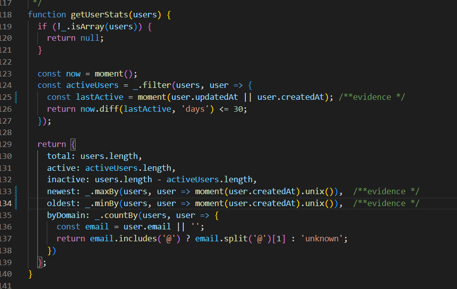
#### Conclusion

The lodash call in `users.js` has a confirmed HTTP execution path involving request-derived data, making it a stronger candidate for further exploitability analysis. In contrast, no execution path to the flagged moment calls was identified in the examined code. Neither finding establishes successful exploitation, and the additional lodash calls in `helpers.js` remain subject to separate reachability analysis.

### 2. Exploitability Check

**Objective:** Determine whether the identified vulnerabilities can be reproduced and distinguish library-level behavior from exploitation through the running application.
**Tools:** A standalone Node.js script for Moment.js and a locally running instance of the application for Lodash.
#### Raw Findings

**Moment — ReDoS (CVE-2022-31129)**

I tested Moment.js v2.19.3 on Node.js v22.23.2 using increasingly long, unclosed-parenthesis strings (`"(".repeat(n)`).

|Input|Length|Parsing time|
|---|---|---|
|Normal date (`2021-01-01`)|10|2.3 ms|
|Crafted input|5,000|55.0 ms|
|Crafted input|10,000|213.3 ms|
|Crafted input|20,000|845.2 ms|

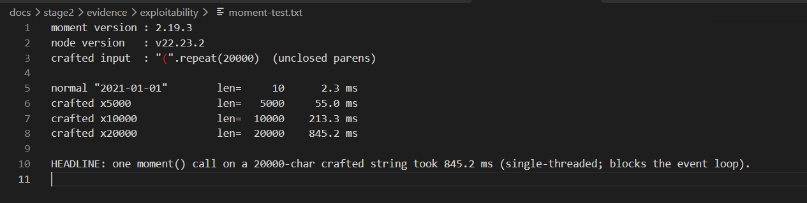

The 20,000-character input took 845.2 ms to process in a single synchronous call, demonstrating significant event-loop blocking potential. However, this test was performed in isolation; no reachable application path to the flagged Moment.js calls was identified.

**Lodash — Prototype Pollution (CVE-2018-16487)**

I tested two prototype pollution payload variants against the locally running application through `PUT /api/users/1`.

|Payload variant|HTTP response|Observed result|
|---|---|---|
|`__proto__`|200|A new empty object inherited `polluted_proto = true`|
|`constructor.prototype`|200|A new empty object inherited `polluted_ctor = true`|

In both cases, the marker was inherited rather than defined as an own property, confirming prototype pollution in the tested process.

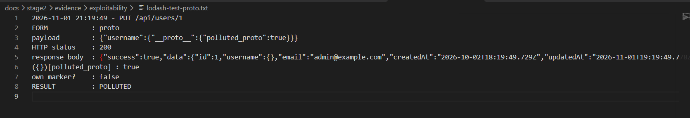

**Cross-request persistence**
A separate test verified whether the pollution persisted beyond the initial request:
- **Before:** `({})[polluted_proto]` returned `undefined`.
- **After** `**PUT /api/users/1**`**:** the marker returned `true`.
- **After an unrelated** `**GET /api/users**`**:** the marker still returned `true`.
- **Process verification:** the server PID remained `2929970` throughout the test.

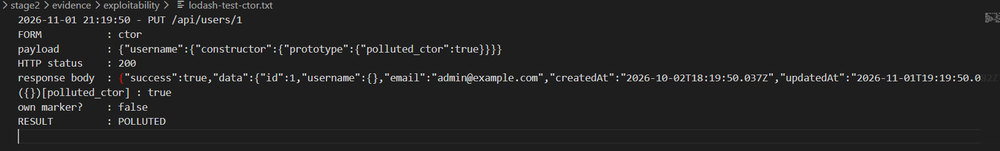


**Risk Assessment and Remediation Choice**

The tests showed that both libraries contain vulnerable functionality, but only Lodash had a confirmed exploitation path through the application's HTTP interface. The prototype pollution persisted across requests in the same server process, potentially affecting other application components that rely on inherited properties. In contrast, Moment.js demonstrated parsing delays only in isolation, with no identified HTTP path to the affected calls.

I therefore selected **Lodash for remediation**, based on demonstrated application-level risk rather than CVSS severity alone.


### 3. Remediation

#### Approach

I selected Lodash for remediation because its prototype pollution vulnerability was successfully reproduced through the application's HTTP endpoint.

Rather than relying only on a dependency upgrade, I applied three complementary fixes:

| Fix                            | Implementation                                                                                       | Rationale                                                            |
| ------------------------------ | ---------------------------------------------------------------------------------------------------- | -------------------------------------------------------------------- |
| **A. Dependency upgrade**      | Upgraded Lodash from 4.17.4 to 4.17.21                                                               | Removes the targeted vulnerability and several additional known CVEs |
| **B. Input validation**        | Replaced the merge operation with explicit updates of `username` and `email`, accepting only strings | Prevents arbitrary objects from entering the user update logic       |
| **C. Request body protection** | Added middleware rejecting `__proto__`, `constructor`, and `prototype` keys at any depth             | Provides additional protection against similar malicious payloads    |

**Why not upgrade alone?** Although the upgraded Lodash version prevented the tested prototype pollution, the application could still store an object as a username. Input validation addresses this separate data-integrity issue.

**A. Dependency upgrade**: Upgraded Lodash from 4.17.4 to 4.17.21 in `package.json` and `package-lock.json` to address the targeted vulnerability (CVE-2018-16487) and six additional known CVEs.

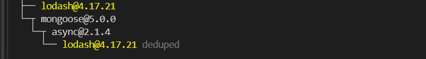

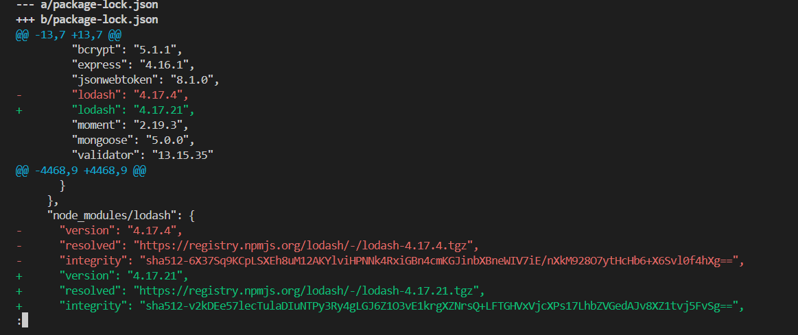

**B. Input validation**: Replaced the vulnerable `_.merge()` call with explicit field updates and string-type validation, rejecting malformed inputs with HTTP 400 and preventing nested objects from reaching the merge operation.

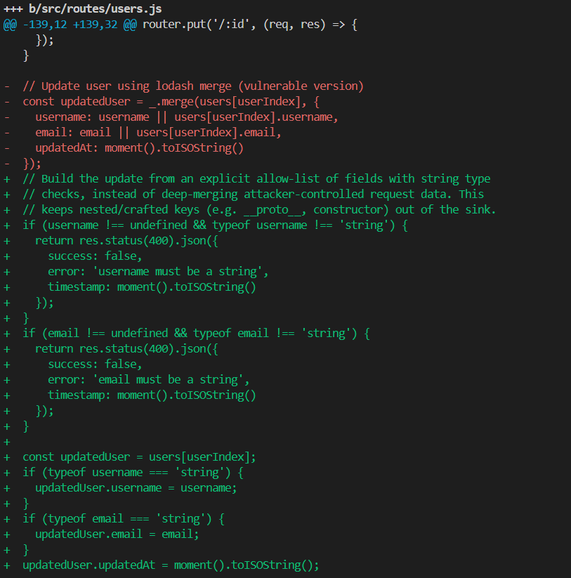

**C. Request Body Protection:** Added middleware that recursively checks incoming request bodies for potentially dangerous keys (`__proto__`, `constructor`, and `prototype`) and rejects matching requests with HTTP 400 before they reach the route handlers.

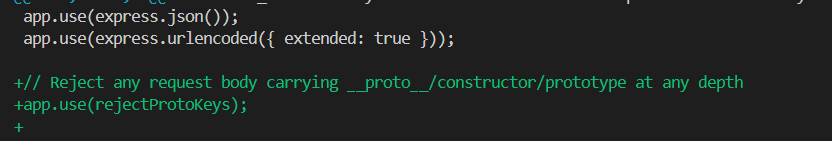

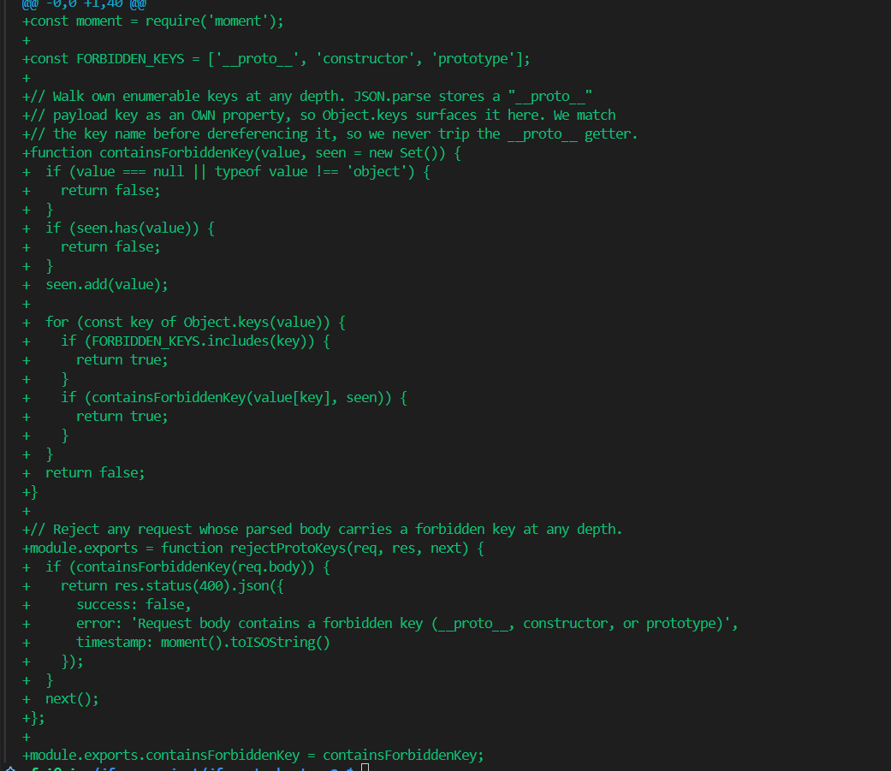

The remediation changes are consolidated in commit `3445eaa` (`fix: remediate lodash prototype pollution`).

### 4.Verification

I verified the remediation through a new JFrog scan, HTTP-based regression tests, and the application's test suite.

**1. Before-and-after scan:** I compared the original and remediated JFrog scan results to verify that upgrading Lodash from 4.17.4 to 4.17.21 removed the targeted CVE-2018-16487 finding. The comparison also showed a reduction in the overall number of reported vulnerabilities, while the Moment.js finding remained outside the remediation scope.

The follow-up JFrog scan confirmed that CVE-2018-16487 was no longer reported after the Lodash upgrade. The total number of findings decreased by seven, while one Applicable finding remained outside the remediation scope.

| Metric                             | Before     | After   |
| ---------------------------------- | ---------- | ------- |
| Lodash version                     | 4.17.4     | 4.17.21 |
| Target CVE-2018-16487              | Applicable | Absent  |
| Total Applicable findings          | 3          | 1       |
| Total findings (original baseline) | 93         | 86      |
| Lodash findings                    | 10         | 3       |
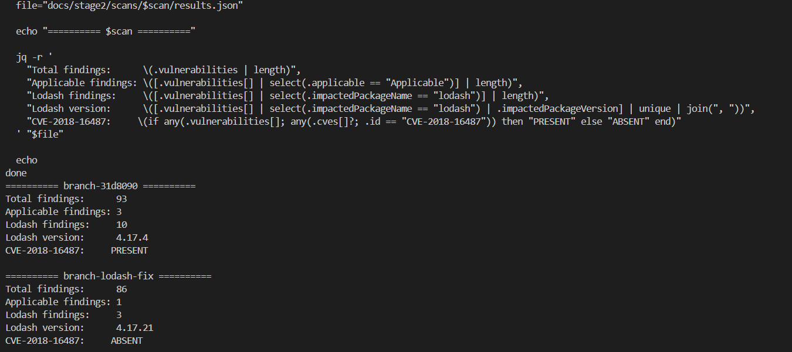

**Scan verification:** Comparing the branch scans before and after the Lodash upgrade, the total findings decreased from 93 to 86, including seven resolved Lodash findings. Applicable findings decreased from 3 to 1, and the targeted CVE-2018-16487 was no longer reported. Both scans included the same 13 `tar` findings, keeping the comparison consistent.

**2. Exploit Regression Tests**

I reran both previously successful prototype pollution payloads against the original application and the remediated configurations. The original application was vulnerable to both payloads, while each remediation layer independently prevented the observed pollution. In the final configuration (Lodash 4.17.21 with input validation and request-body protection), both requests returned HTTP 400, and no prototype pollution was observed.

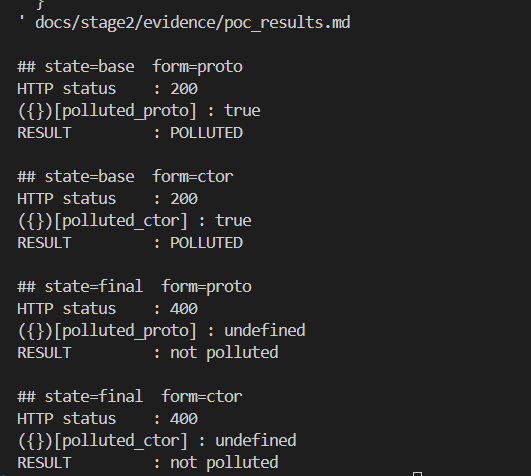
**3. Application Tests**

The application test suite completed successfully (`npm test`: 9/9 passed), providing additional confidence that the remediation did not break the functionality covered by the existing tests.

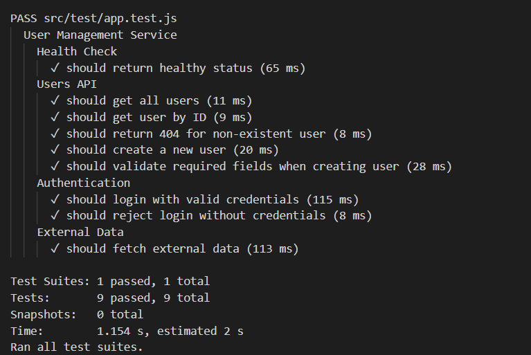

### Conclusion

The remediation successfully addressed CVE-2018-16487, as confirmed by the follow-up JFrog scan and exploit regression tests. Both previously successful prototype pollution payloads were blocked, and all 9 application tests passed. The additional input validation and request-body protection provide defense in depth against similar attacks.

---

### 2e. Docker Image, Artifactory and Build Info

I verified the image architecture and installed Lodash version locally, then retrieved the published Build Info through the Artifactory API to confirm the image tag, digest, Git revision, and associated artifacts.

**Build and publishing flow:**

`stage2/final` → Tests → Docker Buildx build → Image verification → JFrog CLI push → Build Info publication

**Published artifact:**

| Item                              | Verified value                                                     |
| --------------------------------- | ------------------------------------------------------------------ |
| Docker image                      | `trialc914kt.jfrog.io/jt-docker/user-management-service:1e33918`   |
| Image ID (SHA256)                 | `777c214f51d4d662efb1a0d75ca02e7d1a151944704bc11a191214429880cc45` |
| Manifest digest (SHA256)          | `5d12c021a116b4e7b46fd85110cbf515f753a8ec296bef89a054f3bf10511c72` |
| Platform                          | `linux/amd64`                                                      |
| Artifactory deployment repository | `jt-docker-local` (via `jt-docker` virtual repository)             |
| Build Info                        | `user-management-service / 3`                                      |
| Git revision                      | `1e33918eecc7228fddebe4a6a72eb2f03ede36f7`                         |
| Lodash inside image               | `4.17.21`                                                          |

**Verification:** The Docker image platform and installed Lodash version were verified locally. The published Build Info was retrieved through the Artifactory API, confirming the Git revision, Docker image ID, manifest digest, and associated artifacts.

**GitHub Actions workflow (`.github/workflows/publish-build.yml`):** A push to main on 4 Nov 2026 triggered this workflow once. It failed at Setup JFrog CLI, because OIDC is not configured, and built and published nothing. The workflow is now disabled. The published image and Build Info come from the JFrog CLI run described above.

**Evidence:**
- [Published JFrog Build Info #3](https://trialc914kt.jfrog.io/ui/builds/user-management-service/3/1793571105750/published?buildRepo=artifactory-build-info)
- [GitHub — `main`, where the work is](https://github.com/Caspiofri/jfrog-stage2-assessment/tree/main)
- [GitHub — `stage2/final`, the branch recorded in Build Info](https://github.com/Caspiofri/jfrog-stage2-assessment/tree/stage2/final)

**Verification:** I checked the installed Lodash version inside the built image rather than relying only on the local dependency files. This ensures that the published artifact contains the intended remediation, even if Docker's npm version resolves dependencies differently from the local environment.

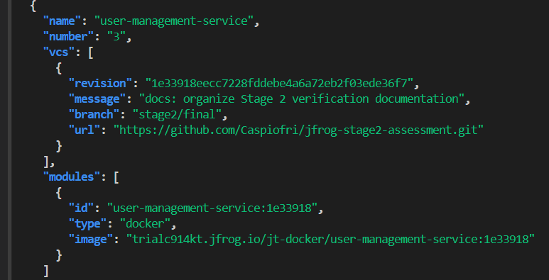

**Supporting evidence:** Raw scan results, reproduction scripts, and verification outputs are included in the repository. See the README for the evidence directory structure and reproduction instructions.
